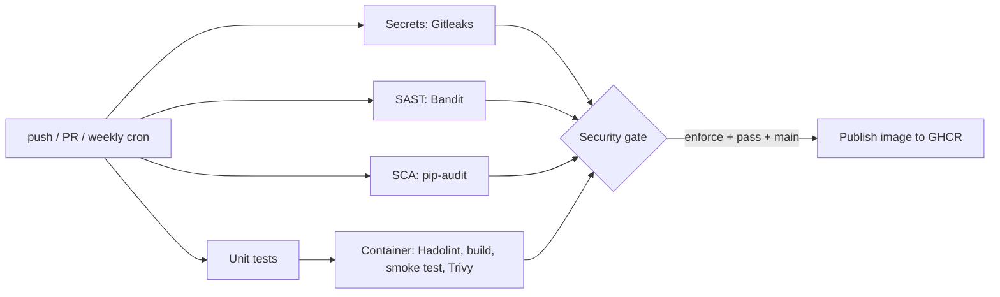

# DevSecOps Pipeline Lab (PR9): VaultNotes + GitHub Actions

A small Flask API wired into a GitHub Actions pipeline that runs **five security
scanners** on every push and pull request, publishes the reports, and decides
whether the build may continue through a **security gate**.

> **Warning:** `app/main.py` is *deliberately insecure* (SQL injection, command
> injection, `eval`, MD5, ...) so the scanners have something real to find.
> Never deploy it. If you run the container locally, bind it to localhost only:
> `docker run -p 127.0.0.1:8000:8000 ...`

## Pipeline



| Stage | Tool | Looks at | What it will flag here |
|---|---|---|---|
| Secrets | Gitleaks 8.30.1 | full git history | the fake `PAYMENT_GATEWAY_API_KEY` in `app/main.py` |
| SAST | Bandit 1.9.4 | Python source (AST) | `shell=True`, MD5, `verify=False`, `debug=True`, SQL f-string, `eval`, `yaml.load` |
| SCA | pip-audit 2.10.1 | `requirements.txt` | old Flask / Werkzeug / Jinja2 / requests / urllib3 / gunicorn ... |
| Dockerfile | Hadolint 2.12.0 | `Dockerfile` | best-practice violations (this Dockerfile is clean) |
| Image | Trivy (via trivy-action v0.36.0) | OS packages + Python libs in the built image | CVEs in the base image and in the pinned libraries |

Reports land in **Actions > run > Artifacts** (JSON), in the run's **Summary** tab
(Markdown tables from `scripts/security_gate.py`), and, for Bandit and Trivy, in
**Security > Code scanning** (SARIF).

## Run it

1. Create an empty repository on GitHub (public is easiest, see Troubleshooting).
2. Push this folder:
   ```bash
   git init -b main
   git add -A && git commit -m "DevSecOps pipeline lab"
   git remote add origin https://github.com/<you>/<repo>.git
   git push -u origin main
   ```
3. Open the **Actions** tab. The `DevSecOps Pipeline` run starts by itself.
4. Open the finished run and look at: the job graph, the **Summary** (gate tables),
   the **Artifacts** list (`gitleaks-report`, `bandit-report`, `pip-audit-report`,
   `hadolint-report`, `trivy-report`) and **Security > Code scanning**.

By default the gate is in **report** mode: the run is green even though findings
exist, and the summary says `WOULD BE BLOCKED`. That mirrors a team rolling out
scanning without blocking developers on day one.

## Gate policy

| Scanner | Violation |
|---|---|
| Gitleaks | any leaked secret |
| Bandit | any finding with severity HIGH |
| pip-audit | any vulnerable package that has a fixed version |
| Trivy | any CRITICAL vulnerability that has a fixed version (unfixable ones are listed but can't block you) |
| Hadolint | any finding with level `error` |

A report that is **missing or unreadable is also a violation** in enforce mode
(fail closed): a scan that never ran must not look like a clean scan.

## Demo: red, then green

1. **Block the build.** Actions > *DevSecOps Pipeline* > **Run workflow** > choose
   `enforce`. (To make it permanent: Settings > Secrets and variables > Actions >
   Variables > new variable `GATE_MODE` = `enforce`.) The `Security gate` job turns
   red and `publish` is skipped.
2. **Fix the code and dependencies.**
   ```bash
   cp docs/fixed/main.py          app/main.py
   cp docs/fixed/test_app.py      tests/test_app.py
   cp docs/fixed/requirements.txt requirements.txt
   git add -A && git commit -m "Remediate scanner findings" && git push
   ```
   Re-run in `enforce` mode. Bandit, pip-audit and Trivy's library findings clear.
   See `docs/REMEDIATION.md` for what changed and why.
3. **Deal with the leaked key.** The gate will *still* be red on Gitleaks, and that
   is correct: Gitleaks scans the whole git history, and the old key is still in an
   earlier commit. Removing a secret from the latest commit does not un-leak it.
   In real life you would **rotate the key first**. Then record that the historical
   finding is handled: download the `gitleaks-report` artifact, copy the
   `Fingerprint` value of the finding (the secret itself is redacted), and put it on
   its own line in a new file named `.gitleaksignore`:
   ```
   # Fake lab key, rotated. Historical commit only.
   <commit-sha>:app/main.py:generic-api-key:23
   ```
   Commit and push. (This exact flow was tested: 1 leak, then 1 leak after the fix
   commit, then 0 with the ignore entry.)
4. Re-run in `enforce` mode. If the gate is green and Trivy's CRITICAL count is 0,
   `publish` pushes the image to `ghcr.io/<you>/vaultnotes`. Trivy results depend on
   the base image on the day you run; if a CRITICAL OS CVE *with* a fix appears, rebuild so the
   base image picks up the patch (or re-run after the next base-image refresh).

## Measured results (local dry-run of the same commands)

| Scanner | Vulnerable version | After `docs/fixed` |
|---|---|---|
| Gitleaks | 1 leak (`generic-api-key`) | 0 on a fresh repo; in your repo see demo step 3 |
| Bandit | 4 HIGH, 6 MEDIUM, 2 LOW | 0 HIGH, 0 MEDIUM, 1 LOW |
| pip-audit | 74 vulnerabilities in 8 packages | 0 |
| Hadolint | 0 | 0 |
| Trivy | *varies daily; run it in CI* | *varies daily* |

Trivy needs Docker and registry access, so I could not run it in the authoring
environment. Expect Debian base-image CVEs from the OS layer plus the library CVEs
pip-audit lists. The numbers change as the vulnerability databases update.

Run the cheap scanners locally:
```bash
pip install -r requirements-dev.txt "bandit[sarif]==1.9.4" pip-audit==2.10.1
python -m pytest -q tests
mkdir -p reports
bandit -r app scripts -f json -o reports/bandit-report.json --exit-zero
pip-audit -r requirements.txt --no-deps --disable-pip -f json -o reports/pip-audit-report.json
python scripts/security_gate.py --reports-dir reports   # missing reports show as MISSING
```

## Design decisions

- **Actions pinned to commit SHAs**, not tags or `@master`. In March 2026 attackers
  force-pushed 76 of 77 `trivy-action` tags to credential-stealing code; a SHA can't
  be moved. Dependabot (`.github/dependabot.yml`) proposes SHA bumps weekly.
- **Gitleaks is downloaded and SHA-256 verified** instead of using a marketplace action.
- **Least privilege:** workflow default is `contents: read`; only the jobs that upload
  SARIF get `security-events: write`, and only `publish` gets `packages: write`.
- **Scan jobs never fail on findings**: they always emit a report, and one place
  (the gate) owns the pass/fail decision.
- **Weekly cron:** a clean commit today can be vulnerable next week.
- **Unpinned Docker tags:** the `hadolint/hadolint:v2.12.0` image is referenced by tag;
  for production, pin container images by digest too.
- **Secrets:** the smoke test passes an optional `SECRET_KEY` repo secret by name
  (never on a command line). The vulnerable app ignores it, the remediated one uses it.
  The publish job authenticates with the built-in `GITHUB_TOKEN`.

## Troubleshooting

- **"Resource not accessible" / SARIF upload fails:** Code scanning needs a public
  repo or GitHub Advanced Security. Those steps are `continue-on-error`, so the rest
  still works; use the artifacts and the run Summary instead.
- **Trivy `TOOMANYREQUESTS` downloading its DB:** re-run the job; the DB comes from
  `ghcr.io` and is rate-limited.
- **Gate shows MISSING for a scanner:** that scan job failed before uploading its
  report. Open that job's log.
- **`publish` skipped:** by design. It only runs on `main`, in `enforce` mode, after
  the gate passes.
- Action versions were verified on 23 Oct 2026. Newer ones will exist; let Dependabot
  propose them.
